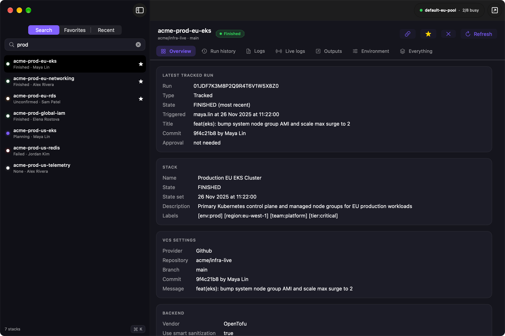
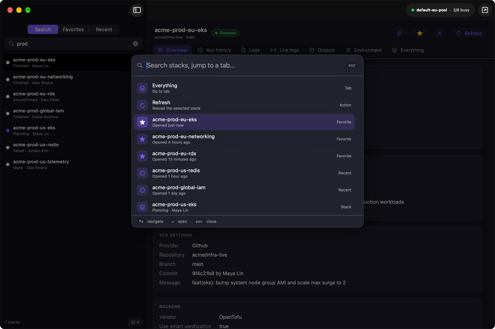
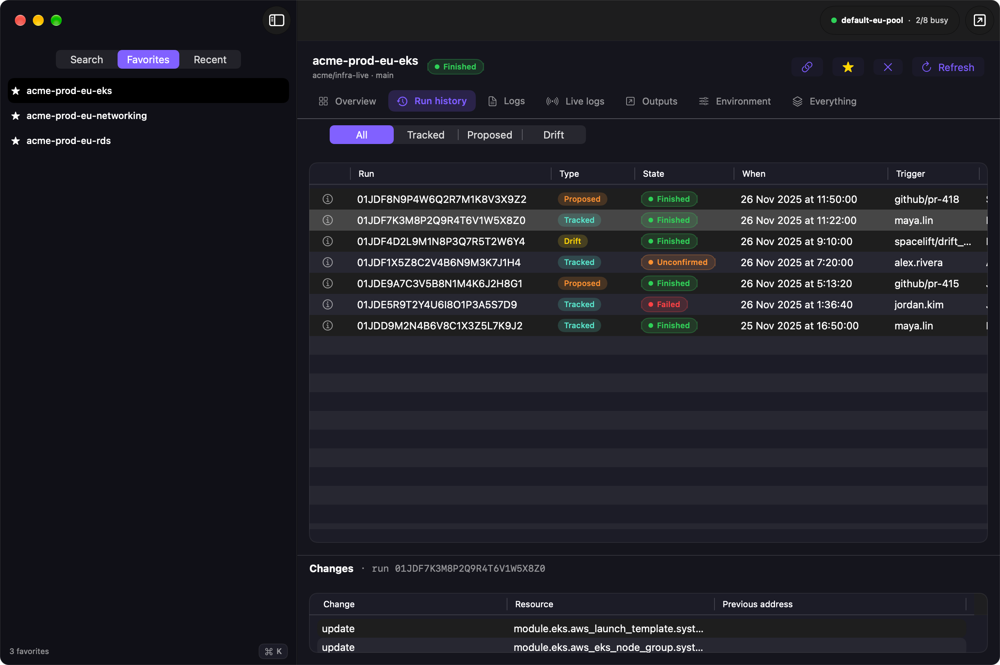
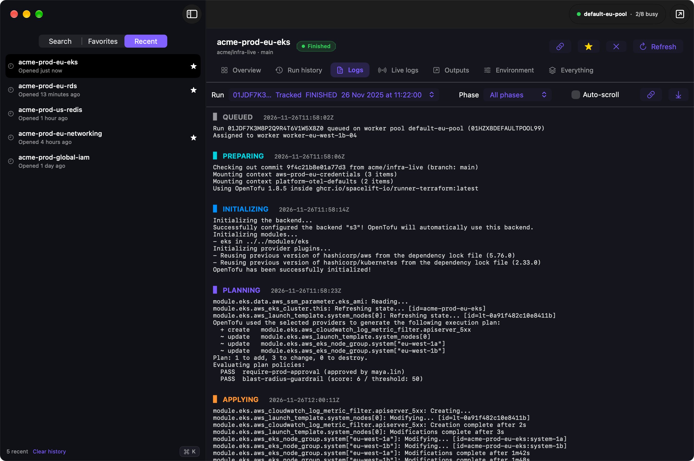
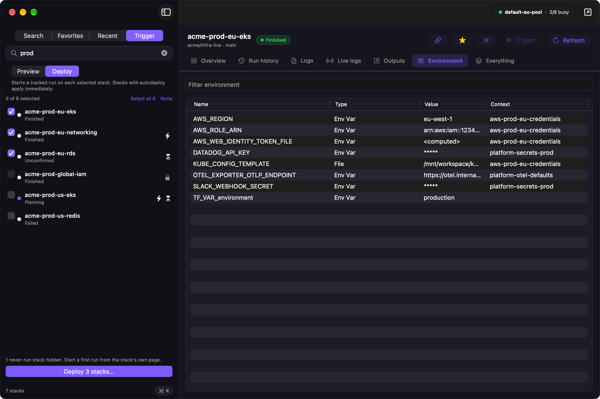

# Spacelift Stacks

An unofficial native macOS SwiftUI app for browsing and inspecting Spacelift stacks. It is **read-only by default**, with optional run actions you can turn on in Settings. It shells out to [`spacectl`](https://github.com/spacelift-io/spacectl), so it uses your existing `spacectl` login, stores no credentials of its own, and shows only what your account can see. Secret values are never exposed.

The full [user manual](MANUAL.md) describes every feature, edge case, and condition in detail.



## Features

### Finding and organizing stacks

- **Search**: debounced server-side stack search (`2+` characters, up to `200` results) showing a colored state dot, stack ID, live state, tracked commit author, and favorite indicator (`★`).
- **Favorites**: dedicated alphabetical list of your starred stacks. Star or unstar the open stack in its header (`★`) or right-click any stack in **Search**, **Favorites**, or **Recent**.
- **Recent**: keeps the last `30` stacks you opened with relative timestamps ("just now", "2 hours ago"). Remove individual entries from the right-click menu or use **Clear history** in the sidebar footer.
- **Quick links**: copy `<endpoint>/stack/<stackID>` from the stack header button or by right-clicking any stack in the sidebar (resolved from `SPACELIFT_API_KEY_ENDPOINT` or your active `spacectl` profile).

### Command palette (`⌘K`)

Press `⌘K` (or click the `⌘K` button in the sidebar footer) to jump between tabs, refresh the open stack, open **Favorite** or **Recent** stacks, filter loaded sidebar stacks locally, or search stacks on the server (`2+` characters, up to `30` results). Multi-word queries match all words; use `↑`/`↓` and `↵` to pick, or `Esc` to dismiss.



### Default worker pool toolbar

- The top-right window toolbar shows the health and capacity of your default worker pool (`busy/registered` workers and queued runs, with a green/orange/red status dot).
- Automatically picks a private pool matching `default`, falls back to your largest private pool, or queries the **Public** worker pool when no private pools exist.
- Refreshes automatically every 60 seconds, when clicked, or on `⌘R`. Hover for full pool details and last-updated time, or click the external-link button (`↗`) to open `<endpoint>/worker-pools` in your browser.

### Stack tabs

Data for each tab loads on demand and is cached per stack until you press **Refresh** (`⌘R`) or switch stacks. Press `×` in the header (or `Esc` when no text field, sheet, popover, or log view has focus) to close the active stack.

- **Overview**: shows the **Latest tracked run** card (or **Latest run** when only proposed/drift runs exist) alongside cards for **Stack** metadata and labels, **VCS settings** (provider, repository, branch, tracked commit hash/author/message), **Backend** (Terraform, OpenTofu, vendor settings, managed state), **Settings** (administrative, worker pool, autodeploy, autoretry, local preview, project root, additional globs, runner image, Terraform version), expandable **Attached contexts** (item counts and names/types only), and **Attached policies**.
- **Run history**: resizable vertical split view with runs on top (`10` tracked + `10` proposed/drift runs fetched in parallel) and the selected run's resource **Changes** (`Change`, `Resource`, `Previous address` for moved resources, cached per run) below.
  - Filter by **All | Tracked | Proposed | Drift** when non-tracked runs exist.
  - Inspect full run metadata via the `ⓘ` row button, right-click > **Details**, or `⌘I`.
  - Double-click (or right-click > **Open logs**) to jump to that run's logs, right-click > **Follow live** for in-progress runs, or right-click > **Copy run link**.
- **Logs**: recorded run output with **Run** and **Phase** (`All phases`, `QUEUED`, `PREPARING`, `INITIALIZING`, `PLANNING`, `APPLYING`, `FINISHED`) pickers. Phase banners are rendered as colored headings with timestamps and terminal ANSI codes stripped. Includes **Auto-scroll**, incremental search (`⌘F`), **Copy run link**, and **Download logs** (`<stackID>-<runID>[-<phase>].log`).
- **Live logs**: streams an active run in real time with `spacectl stack logs --tail` (a live stream, not polling), with **Stop** / **Follow again**, colored phase headings, `⌘F` search, **Copy run link**, and **Download logs**.
- **Outputs**: flattens structured JSON outputs (nested objects and arrays) into dotted paths (such as `node_groups.system.desired`, or `-` for plain values), with an instant **Filter outputs** box matching output name, path, or value.
- **Environment**: lists environment variables and mounted files (**Name**, **Type**, **Value**, **Context**) with an instant **Filter environment** box. Write-only secrets are masked as `*****` and runtime values show `<computed>`.
- **Everything**: combines Overview, Changes, Run history, Outputs, and Environment on a single scrollable page with full-height tables for quick scanning.





## Actions (off by default)

Turn on **Settings (`⌘,`) > Enable actions** to unlock write operations. Actions run `spacectl` as you, use your Spacelift permissions, and always ask for confirmation first. Runs are **never** auto-confirmed or force-applied (`--auto-confirm` and `--force-apply` are never passed).

- **Trigger first run** (stack header and empty-state view): starts the first tracked run (`spacectl stack deploy` at the branch head) on a stack that has never had a tracked deployment. Disabled if the stack has already deployed or if you lack write permission; warns when **autodeploy** is on.
- **Retry failed run**: right-click a `Failed` run in Run history (`spacectl stack retry`) to repeat that run at its original commit.
- **Batch Trigger tab** (sidebar): search stacks, tick targets (or use **Select all N** / **None**), and choose between:
  - **Preview** (default, `spacectl stack preview`): starts plan-only proposed runs across any matching stack, including stacks that have never run. Nothing is applied.
  - **Deploy** (`spacectl stack deploy`): starts tracked runs on stacks that have run before. Rows display indicators for **⚡ autodeploy** (applies immediately), **⌛ blocking run** (queues behind an active run), and **🔒 read-only** (cannot be selected). Confirmation lists autodeploy and blocked stacks by name and requires typing `deploy <count>` or `deploy <search>`.
  - **Throttled batch progress**: keeps at most **3 runs in flight** at once, starting the next stack only after one settles (checked every 10s; `Unconfirmed` and `Pending review` count as settled so human approvals do not stall the queue). Click any batch row to inspect that stack, or press **Stop** to halt starting new stacks (runs already created continue in Spacelift).



## Keyboard shortcuts

| Shortcut | Action |
|---|---|
| `⌘K` | Open or close the command palette |
| `⌘R` | Refresh the open stack and default worker pool status |
| `⌘I` | Toggle the selected run's details popover (Run history) |
| `⌘F` | Find in Logs / Live logs |
| `⌘,` | Open Settings |
| `↑` `↓` `↵` | Navigate and select in the command palette |
| `Esc` | Dismiss palette, sheet, popover, or dialog; otherwise close the open stack |

## Requirements

- macOS 14 (Sonoma) or newer, Apple Silicon or Intel
- [`spacectl`](https://github.com/spacelift-io/spacectl) installed and authenticated

```bash
brew install spacelift-io/spacelift/spacectl
spacectl profile login <your-spacelift-subdomain>
spacectl stack list --limit 1     # should print a stack, not an auth error
```

Because macOS GUI apps do not inherit your shell `PATH`, the app looks for `spacectl` in `/opt/homebrew/bin`, `/usr/local/bin`, `~/.local/bin`, and `~/go/bin`.

## Install

1. Download the zip from the [Releases](../../releases) page (verify it against `SHA256SUMS`), unzip, and drag `spacectl-ui.app` to `/Applications`.
2. The app is ad-hoc signed (not notarized), so macOS Gatekeeper blocks the first launch. Clear the quarantine attribute once:

   ```bash
   xattr -dr com.apple.quarantine /Applications/spacectl-ui.app
   ```

   Alternatively, try to open it once, then go to **System Settings > Privacy & Security > Open Anyway**.
3. Launch the app and type at least 2 characters in the search box (or press `⌘K`).

## Stored data

The app stores only favorite stack IDs, recent stack IDs with open timestamps, and the **Enable actions** toggle in macOS preferences (`io.github.luispcoutinho.spacectl-ui`). No credentials or stack states are persisted locally. To reset everything:

```bash
defaults delete io.github.luispcoutinho.spacectl-ui
```

## Build from source

Requires the Swift toolchain (Xcode or Command Line Tools); no Xcode project is needed.

```bash
./build.sh          # builds universal (arm64 + x86_64) spacectl-ui.app
./build.sh dist     # also writes dist/spacectl-ui-<version>.zip
```

To publish a release, bump `VERSION` in a pull request and merge it to `main`. The Release workflow builds the universal zip, generates `SHA256SUMS`, and publishes GitHub Release `v<VERSION>`.

## Contributing and license

Issues and pull requests are welcome — see [CONTRIBUTING.md](CONTRIBUTING.md). Licensed under the [MIT License](LICENSE).

This project is not affiliated with or endorsed by Spacelift. "Spacelift" is a trademark of its owner.
